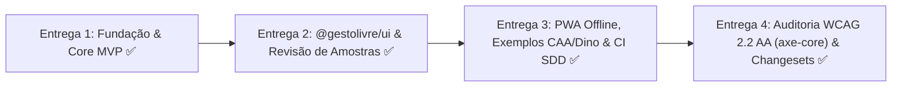

# 📊 Acompanhamento Contínuo de Entregas — GestoLivre

> Documento vivo de rastreabilidade, status e planejamento incremental por entregas, baseado na proposta técnica oficial do **GestoLivre**.

---

## 🧭 Quadro Geral de Status das Entregas

---

## 📋 Matriz de Requisitos vs. Status de Implementação

| ID | Módulo | Descrição do Requisito | Status | Onde está implementado | Teste Automatizado |
|---|---|---|---|---|---|
| **RF-CAM-01** | Câmera | Permissão explícita com aviso de privacidade LGPD prévio | ✅ Concluído | `apps/studio/src/App.tsx` | `packages/core/tests/camera.test.ts` |
| **RF-CAM-02** | Câmera | Listar, escolher e memorizar dispositivo de câmera | ✅ Concluído | `packages/core/src/camera/camera-manager.ts` | `packages/core/tests/camera.test.ts` |
| **RF-CAM-03** | Câmera | Pré-visualização espelhada com overlay de landmarks no Canvas | ✅ Concluído | `apps/studio/src/App.tsx` | `apps/studio/tests/camera-preview.test.ts` |
| **RF-CAM-05** | Câmera | Alternar fontes ativas (Face, Mão, Pose) para poupar CPU | ✅ Concluído | `packages/core/src/vision/vision-detector.ts` | `packages/core/tests/api.test.ts` |
| **RF-CAM-07** | Câmera | Parada imediata e indicador claro de status ativo | ✅ Concluído | `packages/core/src/camera/camera-manager.ts` | `packages/core/tests/camera.test.ts` |
| **RF-TRN-01** | Treino | CRUD de gestos e definição de fontes | ✅ Concluído | `packages/core/src/types.ts` & Studio | `packages/core/tests/profile.test.ts` |
| **RF-TRN-02** | Treino | Gravação de amostras com contagem regressiva e progresso | ✅ Concluído | `packages/ui/src/CountdownOverlay.tsx` | `packages/ui/tests/ui.test.ts` |
| **RF-TRN-03** | Treino | Revisão de amostras (miniatura de landmarks) e exclusão | ✅ Concluído | `packages/ui/src/SampleGalleryModal.tsx` | `packages/ui/tests/ui.test.ts` |
| **RF-TRN-04** | Treino | Treino local k-NN em $\le 5$s com acurácia $\ge 90\%$ | ✅ Concluído | `packages/core/src/classifiers/knn.ts` | `packages/core/tests/classifier-knn.test.ts` (19ms) |
| **RF-TRN-05** | Treino | Treino incremental (adicionar amostras sem recomeçar) | ✅ Concluído | `apps/studio/src/App.tsx` (`Gravar +40`) | Integrado no Studio |
| **RF-TRN-06** | Treino | Assistente guiado obrigatório para classe `neutro` | ✅ Concluído | `apps/studio/src/App.tsx` | Alertas no k-NN e UI |
| **RF-TRN-07** | Treino | Alerta de sobreposição entre gestos / distância para neutro | ✅ Concluído | `packages/core/src/classifiers/knn.ts` | `packages/core/tests/classifier-knn.test.ts` |
| **RF-ACT-01** | Ações | Teste ao vivo com gesto detectado, confiança e latência | ✅ Concluído | `packages/ui/src/LiveMetricsBadge.tsx` | `packages/core/tests/engine.test.ts` |
| **RF-ACT-02** | Ações | Emissão de eventos `gesturestart`, `gesturehold`, `gestureend` | ✅ Concluído | `packages/core/src/engine/decision-engine.ts` | `packages/core/tests/engine.test.ts` |
| **RF-ACT-03** | Ações | Mapeamento gesto $\rightarrow$ ação (Voz, Tecla, DOM, Webhook) | ✅ Concluído | `packages/actions/src/` | `packages/actions/tests/actions.test.ts` |
| **RF-ACT-04** | Ações | Limiar, histerese, sustentação (`holdMs`) e *cooldown* | ✅ Concluído | `packages/core/src/engine/decision-engine.ts` | `packages/core/tests/engine.test.ts` |
| **RF-ACT-05** | Ações | Pausa de emergência imediata (< 200 ms / tecla Escape) | ✅ Concluído | `packages/ui/src/EmergencyButton.tsx` | `packages/core/tests/engine.test.ts` |
| **RF-ACT-06** | Ações | Registro (log) visual em tempo real dos disparos | ✅ Concluído | `apps/studio/src/App.tsx` | Integrado no Studio |
| **RF-PRF-01** | Perfis | Persistência local em IndexedDB | ✅ Concluído | `packages/core/src/profile/profile-manager.ts` | `packages/core/tests/profile.test.ts` |
| **RF-PRF-02** | Perfis | Exportar/importar perfil `.gestolivre.json` | ✅ Concluído | `packages/core/src/profile/profile-manager.ts` | `packages/core/tests/profile.test.ts` |
| **RF-PRF-04** | Perfis | Exclusão de todos os dados locais com confirmação (LGPD) | ✅ Concluído | `packages/core/src/profile/profile-manager.ts` | `packages/core/tests/profile.test.ts` |
| **RF-API-01** | Core API | Pacote com tipos TypeScript estritos, ESM e CJS | ✅ Concluído | `packages/core/package.json` | `packages/core/tests/api.test.ts` |
| **RNF-01/02** | Desempenho | Latência $\le 100$ms e FPS $\ge 24$ | ✅ Concluído | Painel em tempo real | `apps/studio` |
| **RNF-03** | Desempenho | Treino em $\le 5$s com k-NN | ✅ Concluído | `packages/core/src/classifiers/knn.ts` | 19 ms no teste |
| **RNF-04** | Privacidade | Zero upload de imagens ou vídeo; apenas landmarks | ✅ Concluído | Arquitetura local | Verificado |
| **RNF-05** | Privacidade | Funcionamento offline após 1º carregamento (PWA) | ✅ Concluído | `apps/studio/public/sw.js` & manifest | PWA Service Worker |
| **RNF-07** | Acessibilidade | WCAG 2.2 AA (contraste, foco, alvos $\ge 44$px) | ✅ Concluído | `packages/ui/tests/accessibility.test.tsx` | 4 testes com `axe-core` |

---

## 📦 Detalhamento das Entregas Realizadas

### Entrega 1: Fundação, Spec-Driven Development e MVP do Core
- Monorepo `pnpm workspaces` com TypeScript 5 estrito.
- Especificações em `spec/` (critérios Dado/Quando/Então vinculados à matriz).
- `@gestolivre/core`: normalização anatômica, classificador k-NN instantâneo, motor com histerese e `holdMs`, controle de câmera e perfis.
- `@gestolivre/actions`: executores de Voz TTS, Teclado, DOM e Webhook HTTP.
- `GestoLivre Studio`: detecção ao vivo, treino guiado e log de ações.
- Exemplo 1: Passador de slides acionado por gestos (`examples/01-slides`).

### Entrega 2: Biblioteca `@gestolivre/ui` e Revisão Visual de Amostras (RF-TRN-03)
- Criação do pacote `@gestolivre/ui` com componentes React compartilháveis:
  - `SampleThumbnail`: Mini-canvas de projeção 2D de landmarks/blendshapes.
  - `SampleGalleryModal`: Diálogo modal completo para inspecionar e excluir amostras com falha/ruído individualmente (RF-TRN-03).
  - `CountdownOverlay`: Contagem regressiva (3, 2, 1) com barra de progresso.
  - `LiveMetricsBadge`: Diagnóstico de FPS, latência e confiança.
  - `EmergencyButton`: Botão acessível de pausa de emergência.
- Integração no Studio com botões "Ver Amostras" em cada card e no assistente da classe `neutro`.
- Treino incremental com botão "Gravar +40" sem perda de dados anteriores (RF-TRN-05).

### Entrega 3: PWA Offline, Exemplos CAA/Dino e CI SDD Automatizado
- **PWA Offline Completo (RNF-05)**:
  - Web App Manifest (`apps/studio/public/manifest.webmanifest`) com ícone SVG nativo.
  - Service Worker (`apps/studio/public/sw.js`) com cache de ativos e dos modelos WASM do MediaPipe.
- **Exemplo 2 — Comunicador Vocal CAA (`examples/02-communicator`)**:
  - Prancha com 8 cartões essenciais e síntese de voz para pessoas não-verbalizadas.
- **Exemplo 3 — Jogo do Dinossauro (`examples/03-dino-game`)**:
  - Jogo Canvas estilo Chrome Dino controlado por salto facial.
- **CI SDD Automatizado**:
  - Script `scripts/verify-specs.js` que audita 19 requisitos vinculados a testes.
  - Workflow GitHub Actions (`.github/workflows/ci.yml`).

### Entrega 4: Auditoria de Acessibilidade (axe-core) e Publicação (Changesets)
- **Auditoria WCAG 2.2 AA Automatizada (CA-RNF-04)**:
  - Testes automatizados com `axe-core` em `packages/ui/tests/accessibility.test.tsx` cobrindo todos os componentes visuais interativos.
  - Resultado: **Zero violações graves ou críticas** detectadas.
- **Changesets e Versionamento Semântico**:
  - Configuração de `.changeset/config.json`.
  - Scripts `pnpm changeset`, `pnpm version-packages` e `pnpm release` adicionados ao `package.json`.
- **Guia de Contribuição**:
  - Criação de `CONTRIBUTING.md` com padrões de código, comandos e fluxo SDD.
- **Validação Global**: **23 testes automatizados passando (100%)**.
