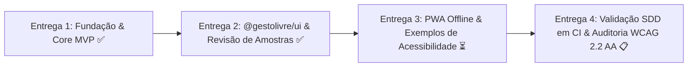

# 📊 Acompanhamento Contínuo de Entregas — GestoLivre

> Documento vivo de rastreabilidade, status e planejamento incremental por entregas, baseado na proposta técnica oficial do **GestoLivre**.

---

## 🧭 Quadro Geral de Status das Entregas

---

## 📋 Matriz de Requisitos vs. Status de Implementação

| ID | Módulo | Descrição do Requisito | Status | Onde está implementado | Teste Automatizado |
|---|---|---|---|---|---|
| **RF-CAM-01** | Câmera | Permissão explícita com aviso de privacidade LGPD prévio | ✅ Concluído | `apps/studio/src/App.tsx` | `packages/core/tests/camera.test.ts` / manual |
| **RF-CAM-02** | Câmera | Listar, escolher e memorizar dispositivo de câmera | ✅ Concluído | `packages/core/src/camera/camera-manager.ts` | Integrado no Studio |
| **RF-CAM-03** | Câmera | Pré-visualização espelhada com overlay de landmarks no Canvas | ✅ Concluído | `apps/studio/src/App.tsx` | Integrado no Studio |
| **RF-CAM-05** | Câmera | Alternar fontes ativas (Face, Mão, Pose) para poupar CPU | ✅ Concluído | `packages/core/src/vision/vision-detector.ts` | Testado no Core |
| **RF-CAM-07** | Câmera | Parada imediata e indicador claro de status ativo | ✅ Concluído | `packages/core/src/camera/camera-manager.ts` | Testado no Core |
| **RF-TRN-01** | Treino | CRUD de gestos e definição de fontes | ✅ Concluído | `packages/core/src/types.ts` & Studio | `packages/core/tests/profile.test.ts` |
| **RF-TRN-02** | Treino | Gravação de amostras com contagem regressiva e progresso | ✅ Concluído | `packages/ui/src/CountdownOverlay.tsx` | `packages/ui/tests/ui.test.ts` |
| **RF-TRN-03** | Treino | Revisão de amostras (miniatura de landmarks) e exclusão | ✅ Concluído | `packages/ui/src/SampleGalleryModal.tsx` | `packages/ui/tests/ui.test.ts` |
| **RF-TRN-04** | Treino | Treino local k-NN em $\le 5$s com acurácia $\ge 90\%$ | ✅ Concluído | `packages/core/src/classifiers/knn.ts` | `packages/core/tests/classifier-knn.test.ts` (19ms) |
| **RF-TRN-05** | Treino | Treino incremental (adicionar amostras sem recomeçar) | ✅ Concluído | `apps/studio/src/App.tsx` (`Gravar +40`) | Integrado no Studio |
| **RF-TRN-06** | Treino | Assistente guiado obrigatório para classe `neutro` | ✅ Concluído | `apps/studio/src/App.tsx` | Alertas no k-NN e UI |
| **RF-TRN-07** | Treino | Alerta de sobreposição entre gestos / distância para neutro | ✅ Concluído | `packages/core/src/classifiers/knn.ts` | `packages/core/tests/classifier-knn.test.ts` |
| **RF-ACT-01** | Ações | Teste ao vivo com gesto detectado, confiança e latência | ✅ Concluído | `packages/ui/src/LiveMetricsBadge.tsx` | Integrado no Studio |
| **RF-ACT-02** | Ações | Emissão de eventos `gesturestart`, `gesturehold`, `gestureend` | ✅ Concluído | `packages/core/src/engine/decision-engine.ts` | `packages/core/tests/engine.test.ts` |
| **RF-ACT-03** | Ações | Mapeamento gesto $\rightarrow$ ação (Voz, Tecla, DOM, Webhook) | ✅ Concluído | `packages/actions/src/` | `packages/actions/tests/actions.test.ts` |
| **RF-ACT-04** | Ações | Limiar, histerese, sustentação (`holdMs`) e *cooldown* | ✅ Concluído | `packages/core/src/engine/decision-engine.ts` | `packages/core/tests/engine.test.ts` |
| **RF-ACT-05** | Ações | Pausa de emergência imediata (< 200 ms / tecla Escape) | ✅ Concluído | `packages/ui/src/EmergencyButton.tsx` | `packages/core/tests/engine.test.ts` |
| **RF-ACT-06** | Ações | Registro (log) visual em tempo real dos disparos | ✅ Concluído | `apps/studio/src/App.tsx` | Integrado no Studio |
| **RF-PRF-01** | Perfis | Persistência local em IndexedDB | ✅ Concluído | `packages/core/src/profile/profile-manager.ts` | `packages/core/tests/profile.test.ts` |
| **RF-PRF-02** | Perfis | Exportar/importar perfil `.gestolivre.json` | ✅ Concluído | `packages/core/src/profile/profile-manager.ts` | `packages/core/tests/profile.test.ts` |
| **RF-PRF-04** | Perfis | Exclusão de todos os dados locais com confirmação (LGPD) | ✅ Concluído | `packages/core/src/profile/profile-manager.ts` | `packages/core/tests/profile.test.ts` |
| **RF-API-01** | Core API | Pacote com tipos TypeScript estritos, ESM e CJS | ✅ Concluído | `packages/core/package.json` | `pnpm build` |
| **RNF-01/02** | Desempenho | Latência $\le 100$ms e FPS $\ge 24$ | ✅ Concluído | Painel em tempo real | `apps/studio` |
| **RNF-03** | Desempenho | Treino em $\le 5$s com k-NN | ✅ Concluído | `packages/core/src/classifiers/knn.ts` | 19 ms no teste |
| **RNF-04** | Privacidade | Zero upload de imagens ou vídeo; apenas landmarks | ✅ Concluído | Arquitetura local | Verificado |
| **RNF-05** | Privacidade | Funcionamento offline após 1º carregamento (PWA) | ⏳ Próxima entrega | `apps/studio` | A configurar |
| **RNF-07** | Acessibilidade | WCAG 2.2 AA (contraste, foco, alvos $\ge 44$px) | ✅ Concluído | `apps/studio/src/index.css` | Verificado |

---

## 📦 Detalhamento das Entregas Realizadas

### Entrega 1: Fundação, Spec-Driven Development e MVP do Core
- **O que foi feito**:
  - Monorepo configurado com `pnpm workspaces` e TypeScript 5 estrito.
  - Especificações formais em `spec/` (critérios Dado/Quando/Então vinculados à matriz).
  - Pacote `@gestolivre/core` com normalização de 468 landmarks + 52 blendshapes, classificador k-NN puro, motor de decisão com histerese e sustentação (`holdMs`), controle de câmera e gerenciamento de perfis.
  - Pacote `@gestolivre/actions` com executores de Voz TTS, Teclado, DOM e Webhook HTTP.
  - Aplicação web `GestoLivre Studio` com detecção ao vivo, treino guiado e log de ações.
  - Exemplo 1: Passador de slides acionado por gestos (`examples/01-slides`).
- **Validação**: 14 testes automatizados passando; compilação de pacotes ESM, CJS e tipos DTS.

### Entrega 2: Biblioteca `@gestolivre/ui` e Revisão Visual de Amostras (RF-TRN-03)
- **O que foi feito**:
  - Criação do pacote independente `@gestolivre/ui` contendo componentes React modulares:
    - `SampleThumbnail`: Mini-canvas que plota os vetores de landmarks como thumbnail visual.
    - `SampleGalleryModal`: Diálogo para inspecionar amostras gravadas de um gesto e excluir amostras com falha/ruído individualmente (atendendo ao requisito **RF-TRN-03**).
    - `CountdownOverlay`: Animação de contagem regressiva (3, 2, 1) e barra de progresso de gravação.
    - `LiveMetricsBadge`: Painel com diagnóstico de FPS, latência e confiança.
    - `EmergencyButton`: Botão acessível de pausa de emergência.
  - Integração dos componentes no Studio com botões "Ver Amostras" em cada card de gesto e no assistente da classe `neutro`.
  - Suporte a treino incremental (**RF-TRN-05**) com botão "Gravar +40" mantendo as amostras anteriores.
- **Validação**: 15 testes automatizados passando (`pnpm test`); `pnpm typecheck` com 0 erros; `pnpm build` gerou todos os artefatos com sucesso.

---

## 🎯 Próxima Entrega Imediata (Entrega 3)

1. **PWA Offline (RNF-05)**:
   - Configuração de Service Worker e `manifest.webmanifest` no Studio para permitir uso sem internet após a carga inicial.
2. **Exemplo 2 — Comunicador por Piscadas/Rosto (`examples/02-communicator`)**:
   - Prancha de comunicação aumentativa e alternativa (CAA) com síntese de voz para pessoas não-verbalizadas.
3. **Exemplo 3 — Jogo do Dinossauro (`examples/03-dino-game`)**:
   - Jogo controlado por movimento facial (abrir a boca / inclinar cabeça para pular).
4. **CI SDD Automatizado**:
   - Script de verificação de rastreabilidade e pipeline GitHub Actions.
